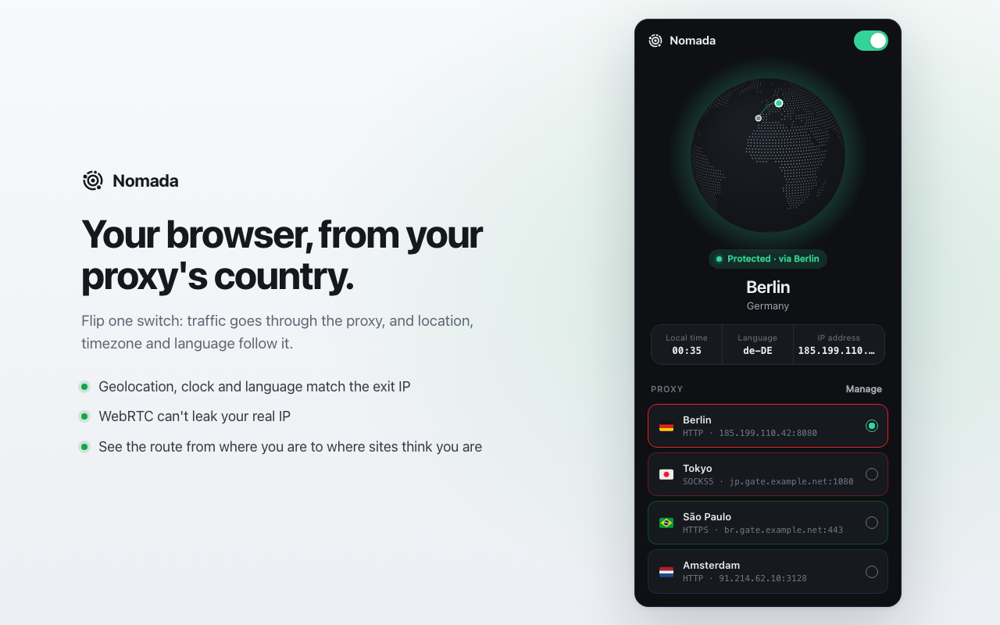
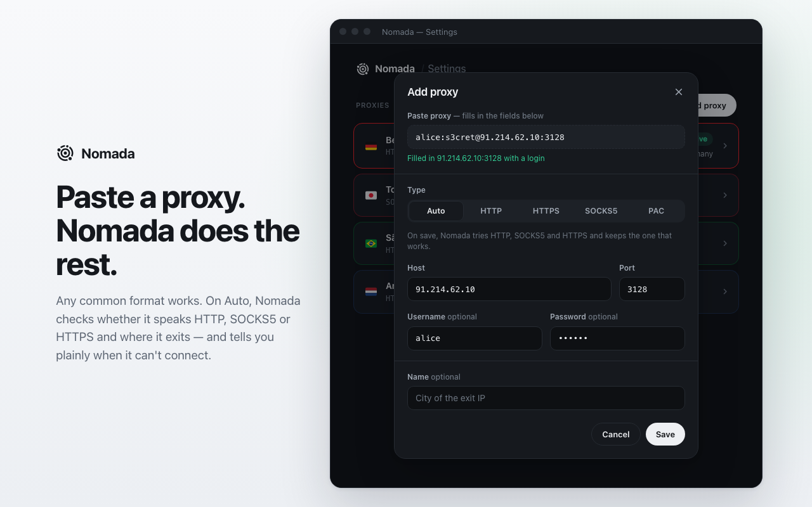
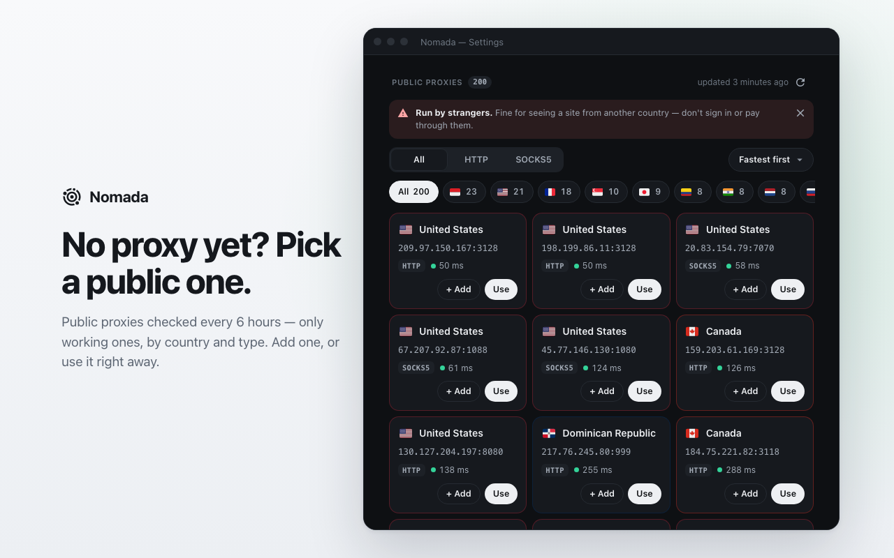

<div align="center">


# Nomada

**Move your browser to wherever your proxy is.**

Flip one switch: your traffic goes through the proxy, and your location, timezone and language follow it.

[](https://chromewebstore.google.com/detail/dfmjgaljomkagpopnknogbokgepfngoe)
[](https://addons.mozilla.org/firefox/addon/nomada-proxy/)
[](https://github.com/legenki/nomada/releases/latest)



</div>

## Why Nomada?

A proxy hides your IP, but your browser keeps telling the truth about everything else. Connect through Berlin with a laptop in New York, and a site can see a German IP next to a New York clock and American English.

Nomada keeps those signals in sync, so sites see one consistent place:

| What a site reads | Proxy alone | With Nomada |
|---|---|---|
| IP address | Proxy's | Proxy's |
| Timezone and clock | Yours | Proxy's |
| Language and regional formats | Yours | Proxy's country |
| Geolocation | Yours | Proxy's coordinates |
| WebRTC | May show your real IP | Can't reveal your real IP |

## What you get

- **One switch.** `Direct` or `Proxy`, and open tabs update right away.
- **Paste any proxy.** `host:port`, `host:port:user:pass`, `user:pass@host:port` or `socks5://…` all work.
- **Automatic setup.** Nomada finds out whether a proxy speaks HTTP, SOCKS5 or HTTPS and which country it exits in. If it can't connect or the login is wrong, it tells you plainly.
- **Backup proxies.** Put your proxies in order and turn on Failover. If one stops answering, Nomada moves to the next, and your location, timezone and language move with it.
- **No leaks when proxies fail.** If none answers, requests are blocked rather than sent from your real IP.
- **A gallery of public proxies.** No proxy yet? Pick a working one by country and type. The list is rechecked every 6 hours.
- **A globe that shows where you are.** See your real location while on `Direct`, and your route to the proxy while on `Proxy`. It turns green while you're protected, and red if no proxy answers.
- **Light or dark.** Follows your system, or pick one on the settings page.
- **No account, no banner.** There is nothing to sign up for, and no "debugging this browser" bar.

<div align="center">


</div>

## Install

| Browser | Get it | Needs |
|---|---|---|
| **Chrome** and Chromium browsers | [Chrome Web Store](https://chromewebstore.google.com/detail/dfmjgaljomkagpopnknogbokgepfngoe) | Chrome 110+ |
| **Firefox** | [Firefox Add-ons](https://addons.mozilla.org/firefox/addon/nomada-proxy/) | Firefox 140+ |

Store updates pass a review, so a new version can appear on [Releases](https://github.com/legenki/nomada/releases) before it reaches a store.

## Get started

1. Click the Nomada icon, then **Manage**, and paste your proxy. Or pick one from the gallery.
2. Switch from `Direct` to `Proxy`.
3. That's it. The popup shows the place, local time, language and IP that sites now see.

To add backups, add more proxies and choose **Failover** in the popup.

## Good to know

**Nomada is not a VPN and doesn't make you anonymous.** It aligns the signals listed above. Sites can still recognise you in other ways, such as cookies, accounts and browser fingerprinting. Your connection to an HTTP proxy isn't encrypted, and whoever runs a proxy can see where your traffic goes.

**Be careful with public proxies.** They're run by strangers, who can see which sites you visit and read or change anything not sent over HTTPS. Use them to see a site from another country, not to sign in, pay or send anything private.

**Chrome and Firefox differ a little:**

| | Chrome | Firefox |
|---|---|---|
| HTTP, HTTPS and SOCKS5 proxies | ✓ | ✓ |
| SOCKS5 with a username and password | – | ✓ |
| PAC scripts | ✓ | – |

In Firefox, allow Nomada under **Run in Private Windows** in `about:addons` if you want it there too.

## Privacy

Your settings stay in your browser. Nomada has no account and no analytics, and it doesn't collect or sell your data. It makes two kinds of outside requests:

- **[ipwho.is](https://ipwho.is)** is asked where an IP address is, so Nomada can show and match locations.
- **GitHub** serves the public proxy list to the settings page.

The [privacy policy](PRIVACY.md) has the details.

## Build it yourself

You need Node.js 20 or later.

```bash
npm ci
npm run build
```

- **Chrome:** open `chrome://extensions`, turn on Developer mode, choose **Load unpacked** and select `dist/`.
- **Firefox:** run `npm run build:firefox`, then `npm run start:firefox`.

| Command | What it does |
|---|---|
| `npm test` | Runs the unit tests (Vitest) |
| `npm run typecheck` | Checks the TypeScript |
| `npm run dev:popup` | Rebuilds the popup on every change |
| `npm run lint:firefox` | Runs Mozilla's `web-ext lint` on the Firefox build |
| `npm run package` | Builds the Chrome zip |
| `npm run package:firefox` | Builds the Firefox zip and source archive |

It's TypeScript and plain DOM, bundled with Vite, with D3 for the globe. One code base builds both browsers:

```
src/background/    routing, failover, location lookups
src/content/       page scripts for timezone, language and geolocation
src/popup/         the popup and globe
src/options/       the settings page and proxy gallery
tools/proxy-list/  the job that checks the public proxies
tests/             unit tests
```

[BUILD.md](BUILD.md) covers packaging and releases.

## Feedback

Found a bug or have an idea? [Open an issue](https://github.com/legenki/nomada/issues). It helps to mention your browser, your Nomada version and the proxy type, but please leave out proxy addresses and passwords.

## Credits and license

Thanks to:

- [TheSpeedX/SOCKS-List](https://github.com/TheSpeedX/SOCKS-List) for the proxies the gallery checks
- [DB-IP](https://db-ip.com) for IP geolocation in the gallery (CC-BY 4.0)
- [Twemoji](https://github.com/twitter/twemoji) for the flag artwork (CC-BY 4.0, see [`public/fonts/LICENSE.md`](public/fonts/LICENSE.md))
- [d3-geo](https://github.com/d3/d3-geo) and [topojson-client](https://github.com/topojson/topojson-client) for the globe

Nomada is © Andy Legenki, all rights reserved. The source is public so you can read it, audit it and build it yourself. Third-party parts keep their own licenses.
